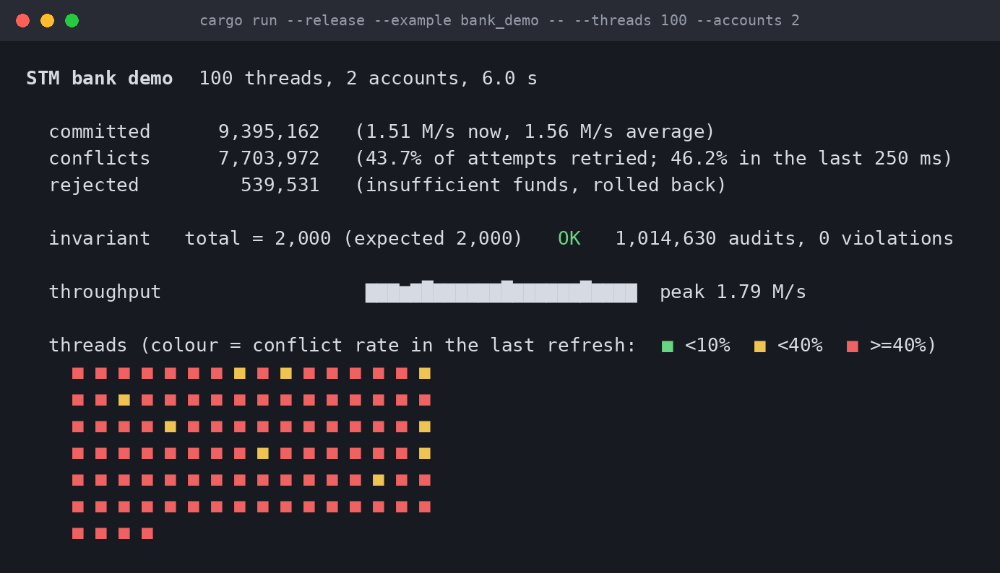
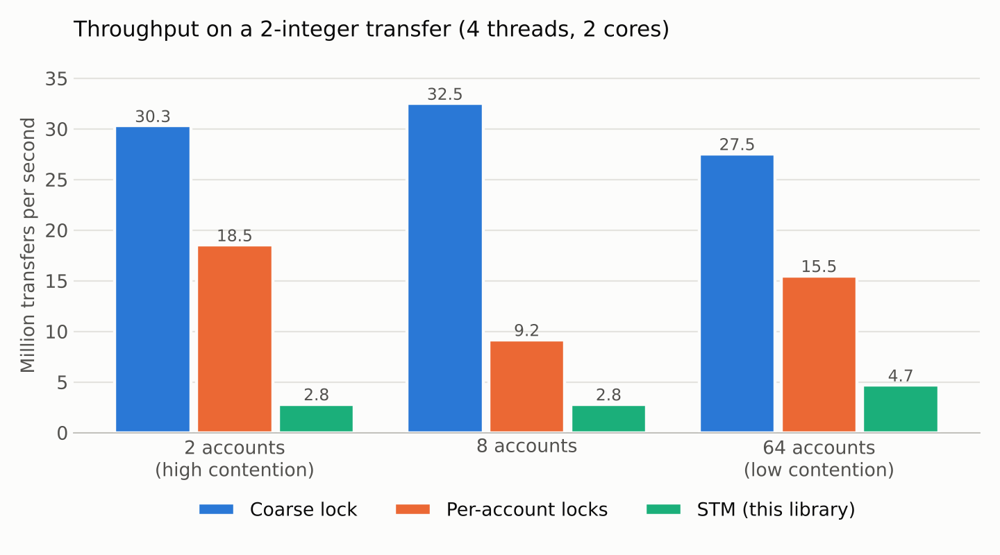
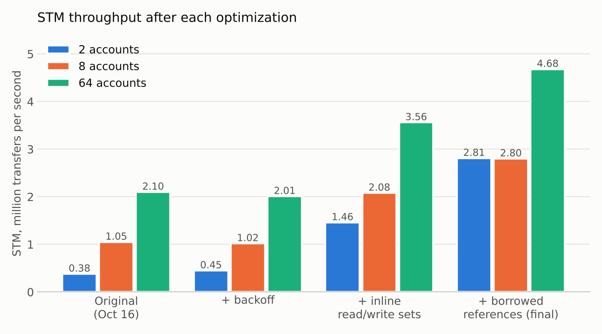

# stm: Software Transactional Memory for Rust

[](https://github.com/KeRon-asm/Software-Transactional-Memory-Library/actions/workflows/ci.yml)
[](LICENSE)

A software transactional memory (STM) library built on the **TL2 (Transactional Locking II)** algorithm. Threads read and write shared state inside atomic transactions. The library detects conflicts and retries, so the caller never takes a lock and cannot deadlock.

```rust
use stm::{atomically, TVar};

let checking = TVar::new(100);
let savings = TVar::new(0);

atomically(|tx| {
    let c = tx.read(&checking)?;
    let s = tx.read(&savings)?;
    tx.write(&checking, c - 30);
    tx.write(&savings, s + 30);
    Ok(())
});
```



*100 threads hammering 2 accounts. Almost every transaction collides and retries (red cells), and an auditor thread that sums every account over a million times never sees a wrong total.*

## Highlights

- **TL2 commit protocol**: global version clock, per-variable versioned locks, read-set validation, write-set locking in a fixed global order.
- **Opacity**: reads are validated as they happen, so a transaction body never computes on an inconsistent snapshot, even on an attempt that is later retried.
- **Model-checked with [`loom`](https://github.com/tokio-rs/loom)**: 4 scenarios, about 5,300 interleavings, run against the real library code through a swappable sync layer. Five deliberately planted bugs were used to check the suite; it catches the four that break correctness (see [ARCHITECTURE.md](ARCHITECTURE.md#how-the-tests-were-tested)).
- **Acquire/release memory ordering**, not blanket `SeqCst`, with the argument written down and checked by loom.
- **Zero-cost borrowing**: the read-set and write-set hold `&'env` references tied to the transaction's lifetime, not reference-counted handles, so recording a read costs no atomic operation and a dangling `TVar` is a compile error.
- **Measured, not assumed**: criterion benchmarks against coarse-grained and per-account locking, an ablation of each optimization, and an honest account of where STM loses.

## Results

All numbers come from a 2-core Linux machine (4 worker threads), so treat them as relative, not absolute.

### Correctness

| Check | Result |
|---|---|
| Unit, integration and doc tests | 35 passing (`cargo test`), including a `compile_fail` test for dangling `TVar` references |
| Bank-transfer invariant, 8 threads x 10,000 transfers, 8 and 2 accounts | total conserved; concurrent auditor never sees a wrong sum |
| Same transfers without STM (naive load/store) | total drifts (money created or destroyed) |
| `loom` model checking, 4 scenarios, preemption bound 4 | ~5,300 interleavings, no failures |
| Live demo, 100 threads x 2 accounts, 6 s | 9.4 M commits, 43.7% retried, 1,014,630 audits, 0 violations |
| Opposite-direction transfers with per-account locks taken in transfer order | **deadlocks** within milliseconds; STM finishes |

### Throughput



On this workload (each transfer is two integer additions) **STM is 6 to 12 times slower than one coarse lock and 3 to 7 times slower than per-account locks**. A mutex around two additions costs almost nothing, while every transaction pays for a snapshot, a read-set, a write-set, boxed values and validation. STM's case is composability and freedom from lock-ordering bugs, not raw speed on tiny critical sections. When the critical section blocks (the deadlock demo yields while holding its locks), STM finished 1.5 to 2.2 times faster than correctly ordered locks in 5 out of 5 runs.

### Optimization



| Change | 2 accounts | 8 accounts | 64 accounts |
|---|---|---|---|
| Original implementation | 0.38 M/s | 1.05 M/s | 2.10 M/s |
| + exponential backoff on retry | 0.45 | 1.02 | 2.01 |
| + inline small-vector read/write sets (no `HashMap`/`BTreeMap`) | 1.46 | 2.08 | 3.56 |
| + borrowed references instead of `Arc` clones (final) | **2.81** | **2.80** | **4.68** |
| final, backoff removed (control) | 0.74 | 1.02 | 2.69 |

Backoff did nothing for the original code but matters a great deal once transactions are cheap: without it, the 100-thread, 2-account demo collapses to 0.04 M commits/s with 99.98% of attempts retried. The heap allocations in the original were acting as accidental backoff.

## Running it

```bash
cargo test                                            # unit, integration, doc tests
RUSTFLAGS="--cfg loom" cargo test --release --test loom -- --nocapture   # model checking
cargo bench                                           # criterion: STM vs coarse vs per-account locks

cargo run --release --example bank_demo               # live dashboard (64 threads, 10 accounts)
cargo run --release --example bank_demo -- --threads 100 --accounts 2
cargo run --release --example deadlock_demo           # the bug STM prevents
cargo run --example conflict_trace                    # one conflict and retry, narrated
cargo run --example conflict_trace --features trace   # plus the library's per-attempt log
```

## API

| Item | Purpose |
|---|---|
| `TVar<T>` | A transactional variable. `Clone` gives another handle to the same cell. |
| `atomically(\|tx\| ...)` | Run a transaction, retrying on conflict until it commits. |
| `try_atomically(\|tx\| ...)` | Same, but the body can abort with its own error (`TxError::Failed`), discarding its writes. |
| `tx.read(&var)?` / `tx.write(&var, v)` | Read (with read-your-own-writes) and buffer a write. |
| `stm::thread_stats()` | This thread's commit, conflict and abort counters. |
| feature `trace` | Log every attempt (read version, set sizes, outcome) to stderr. |

## How it works

1. **Start**: read the global version clock as the transaction's read version `rv`.
2. **Run the body**: each read checks the variable is unlocked and its version is at most `rv`; otherwise the attempt aborts immediately. Writes are buffered.
3. **Commit** (writers only): lock the write-set in ascending id order, bump the clock to get the write version `wv`, validate the read-set (skipped when `wv == rv + 1`), write back stamped with `wv`, unlock.
4. **Retry** on any conflict, with bounded exponential backoff.

[ARCHITECTURE.md](ARCHITECTURE.md) explains every design decision, the memory-ordering argument, and how the tests were checked.

## Project layout

```
src/
  lib.rs           public API and re-exports
  clock.rs         global version clock
  tvar.rs          TVar<T>: value + version + commit lock
  transaction.rs   read/write sets, commit protocol, atomically(), backoff
  stats.rs         per-thread commit/conflict counters
  sync.rs          std/parking_lot primitives, swapped for loom's under --cfg loom
tests/
  bank_transfer.rs concurrent transfers, auditor, naive comparison
  loom.rs          model-checked interleavings
benches/
  transfer_bench.rs  STM vs coarse lock vs per-account locks
examples/
  bank_demo.rs     live terminal dashboard
  deadlock_demo.rs lock-ordering deadlock vs STM
  conflict_trace.rs a single conflict and retry, narrated
```

## Limitations

See [ARCHITECTURE.md](ARCHITECTURE.md#known-limitations) and [ROADMAP.md](ROADMAP.md). In short: no blocking `retry`/`or_else`, nested `atomically` calls are not composed into the outer transaction, values are cloned on read, and the global clock is a single contended counter.

## References

1. N. Shavit and D. Touitou, "Software Transactional Memory," *PODC*, 1995.
2. D. Dice, O. Shalev, and N. Shavit, "Transactional Locking II," *DISC*, 2006.
3. T. Harris, S. Marlow, S. Peyton Jones, and M. Herlihy, "Composable Memory Transactions," *PPoPP*, 2005.
4. M. Herlihy and N. Shavit, *The Art of Multiprocessor Programming*, Morgan Kaufmann, Ch. 18.
5. R. Guerraoui and M. Kapalka, "On the Correctness of Transactional Memory," *PPoPP*, 2008 (opacity).
6. Tokio project, *loom: concurrency permutation testing for Rust*, https://github.com/tokio-rs/loom

## Acknowledgments

Built as a course project for CSC 4330 (Programming Language Concepts). AI assistance (Claude, by Anthropic) was used substantially for implementation, testing, performance work and documentation, as required by the course's acknowledgment policy.

## License

[MIT](LICENSE)
